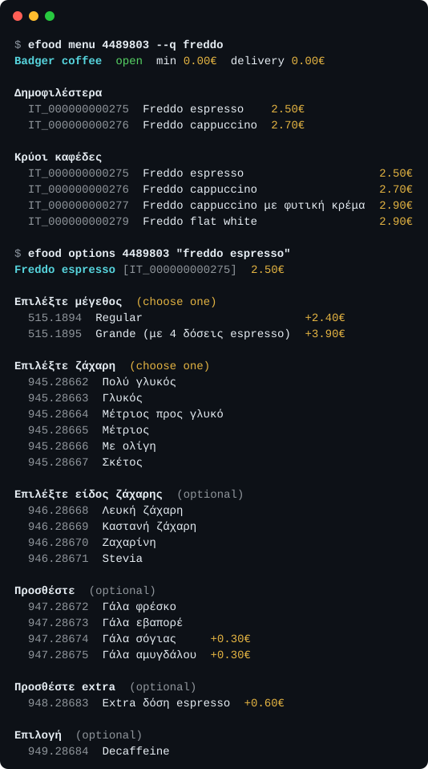

# efood-api

Unofficial client for efood.gr: a TypeScript library, a command-line tool, and a small HTTP service for automations (anything that can send an HTTP request). Node 20 or newer; the only runtime dependencies are for logging (pino).

With it you can log in, list past orders, browse shops and menus, fill the cart and place an order, either by hand or on a schedule.

<p align="center"></p>

It is not affiliated with efood. It talks to the same endpoints the efood app and website use, which can change without notice. Use it with your own account, at your own risk.

## Status

| Part | State |
|---|---|
| Shop list, menu, item options | Works; checked against the live API, no login needed |
| Login, addresses, past orders, order status | Works; checked with a real session |
| Saved cart (add, remove, clear) and dry-run checkout | Works; checked with a real session |
| Placing an order (cash) | Works; one real order placed, through the HTTP service from Home Assistant |
| Saved cards, dry-run checkout paying by card | Works; checked with a real session |
| Placing an order (saved card) | Works; one real order placed. When the bank asks for a confirmation (3-D Secure), you approve it in a browser; that path has been seen but not completed for real |

## Setup

```sh
npm install
npm run build
npm link        # optional: makes the `efood` command available everywhere
```

Without `npm link`, use `node dist/src/cli.js` in place of `efood`.

### Log in

The client reuses the session of your browser, so it works whichever way you sign in (email, Google, Apple, Facebook):

1. Log in on https://www.e-food.gr.
2. Open the browser console and run `window.app.userSid` (or copy the value of the `sparks-sid` cookie).
3. Run `efood login` and paste the value.

The session id is stored in `data/state.json`. Treat it like a password: anyone who has it can use your account. Sessions are long-lived (one was still valid after 12 weeks), but efood does not document how long; when one stops working, commands fail with `session_expired` and you repeat the steps above.

## Example: a repeatable order

The shop id, item and options below are examples; use the ones the commands show you.

```sh
efood addresses                        # your saved addresses
efood orders --shop badger             # past orders from one shop (name or shop id)
efood stats --since 2026-01-01         # money spent per shop and in total
efood shops --q badger                 # find the shop id
efood menu 4489803 --q freddo          # find the item
efood options 4489803 "freddo espresso"

efood cart clear 4489803
efood cart add 4489803 "freddo espresso" --opt regular --opt μέτριος
efood cart show 4489803

efood fav save coffee 4489803          # save the cart as a favourite named "coffee"
efood fav order coffee                 # dry run: validates, orders nothing
efood fav order coffee --yes           # places the order, cash on delivery
```

To pay with a card saved on your efood account instead of cash:

```sh
efood cards                                        # saved cards
efood fav save coffee 4489803 --pay card           # the default card
efood fav save coffee 4489803 --pay card --card 1234   # a card by its last four digits
efood checkout 4489803 --pay card                  # one-off, dry run
```

Only cards already saved on the account can be used; add or remove cards in the efood app.

Your bank may ask you to confirm a card payment (3-D Secure). The command line then opens efood's confirmation page in your browser, waits for you to approve, and reports the order once it appears. The library and the service cannot open a browser: they fail with `confirmation_required` and give the link in `details.url`. Nothing is ordered until you approve, and the link is only valid for a few minutes. An unattended order (for example from a scheduler) is therefore only reliable with cash, or with a card your bank does not ask to confirm.

Orders go to the account's default address unless you pass `--address <id>`.

You can also build the cart in the efood app and then run `efood fav save`: the cart is efood's own saved cart, shared with the app.

### Safety rules

- `checkout` and `fav order` only validate unless `--yes` is given (in the library and the service: unless `dryRun` is exactly `false`).
- A favourite is ordered at most once per calendar day unless `--force`.
- A favourite has a price limit (`--max-total`, default: the price when saved plus 20%). An order is refused when the total efood quotes for it, fees included, is above the limit. efood can add a small service fee when the order is placed that its quote does not show (0.10€ on one real order), so the amount charged can be slightly above the quote; the result of a placed order reports the amount charged.
- An order is refused when the shop is closed, does not deliver to the address, does not take the chosen payment method, the card is expired, an item is out of stock, or the total is under the shop minimum.
- If efood's answer to a real order is unclear (the connection dropped, or no order id came back), the command fails with `outcome_unknown`, and a favourite is not retried that day. Check the efood app.
- Card payment tokens are fetched right before each order and are never stored or logged.
- Every placed order is appended to `data/orders.log`.

Required options are never guessed: if an item needs a size or a sweetness and you did not give one, `cart add` fails and lists the choices.

## Logging

Logging is off by default (the service logs at `info`). Turn it on to see what the client is doing: how many calls it made to efood, to which endpoints, how long they took and what came back.

```sh
efood orders -v                                  # one line per efood call, plus a summary
efood checkout 4489803 --log-level trace         # also the request and response bodies
efood fav order coffee --yes --log-file efood.log --log-level debug
```

| Level | What is logged |
|---|---|
| `silent` | Nothing |
| `error` | Failures of the tool itself, and orders whose outcome is unknown |
| `warn` | Failed or retried efood calls, commands that failed and why, refused service requests, a bank confirmation request |
| `info` | Orders (dry run, placing, placed), session changes, each service request, a summary of the efood calls made |
| `debug` | One line per efood call: method, path, query, HTTP status, duration, size |
| `trace` | The same plus request and response bodies (large ones are cut short) |

Set it with flags or with the environment (also from `.env`):

| Flag | Variable | Meaning |
|---|---|---|
| `--log-level <level>`, `-v` for `debug` | `EFOOD_LOG_LEVEL` | How much to log |
| `--log-file <path>` | `EFOOD_LOG_FILE` | Append to a file instead of writing to stderr. A relative path in the variable is inside the project folder; one given to the flag is relative to where you run the command |
| | `EFOOD_LOG_FORMAT` | `pretty` (one readable line per entry: time, level, a sentence, then the details), `expanded` (the same with the details listed underneath, one per line) or `json` (one object per line, for tools). Default: `pretty` on a terminal, `json` otherwise |

To log every command without typing flags, put the variables in `.env`:

```
EFOOD_LOG_LEVEL=debug
EFOOD_LOG_FILE=./data/efood.log
EFOOD_LOG_FORMAT=pretty
```

A `pretty` entry looks like this:

```
[13:50:10.076] DEBUG: POST /api/carts/retrieve -> 200 in 260 ms {"call":1,"method":"POST","host":"www.e-food.gr","path":"/api/carts/retrieve","auth":true,"httpStatus":200,"ms":260,"bytes":9124}
```

A log file is appended to and never trimmed, so delete it when it gets long. Logs go to stderr unless a file is set, so `--json` output stays clean. The session id, card payment tokens and the token in a bank confirmation link are removed before anything is written, and request headers are never logged. Bodies logged at `trace` still contain personal data (addresses, order contents, masked card numbers), so do not share a trace log as it is.

In the library, pass your own pino logger, or let it read the variables above; `efood.requestStats()` returns the call counts:

```ts
import { Efood, createLogger } from 'efood-api';

const efood = new Efood({ logger: createLogger({ level: 'debug', file: 'efood.log' }) });
await efood.orders();
efood.requestStats();   // { requests, failed, retries, totalMs, byEndpoint }
```

## Library

```ts
import { Efood } from 'efood-api';

const efood = new Efood();                       // loads the saved session
await efood.setSession(sid);
await efood.orders({ limit: 10 });
await efood.orders({ shop: 'badger' });           // or a shop id
await efood.stats({ since: '2026-01-01' });      // spending per shop, per year and in total
await efood.shops({ query: 'coffee', openOnly: true });
await efood.menu(shopId);
await efood.itemOptions(shopId, 'freddo espresso');
await efood.cart(shopId).add({ item: 'freddo espresso', options: ['regular', 'μέτριος'] });
await efood.checkout(shopId);                    // dry run
await efood.cards();
await efood.checkout(shopId, { payment: 'card', card: '1234', dryRun: false });
await efood.favorites.saveFromCart('coffee', shopId);
await efood.favorites.order('coffee', { dryRun: false });
```

Errors are `EfoodError` with a stable `code`: `no_session`, `session_expired`, `blocked`, `rate_limited`, `network_error`, `api_error`, `not_found`, `ambiguous`, `option_not_found`, `bad_request`, `empty_cart`, `shop_closed`, `out_of_stock`, `below_minimum`, `over_max_total`, `payment_unavailable`, `confirmation_required`, `outcome_unknown`, `already_ordered_today`.

## HTTP service

```sh
cp .env.example .env     # set EFOOD_API_TOKEN
efood serve              # http://0.0.0.0:8787
```

Settings, from the environment or `.env`:

| Variable | Meaning | Default |
|---|---|---|
| `EFOOD_API_TOKEN` | Token callers must send. Required. | none |
| `EFOOD_PORT` | Port to listen on | `8787` |
| `EFOOD_HOST` | Interface to listen on | `0.0.0.0` |
| `EFOOD_DATA_DIR` | Where the session, favourites and order log are kept. A relative path is inside the project folder | `data/` in the project |
| `EFOOD_LOG_LEVEL`, `EFOOD_LOG_FILE`, `EFOOD_LOG_FORMAT` | Logging, see [Logging](#logging) | `info` for the service, to stderr |

Every request needs `Authorization: Bearer <EFOOD_API_TOKEN>`.

| Route | Purpose |
|---|---|
| `GET /health` | `{ok, session: valid/expired/missing/unknown, user, lastOrders}` |
| `POST /session` | Body `{"sessionId": "..."}`: check and save a new session |
| `GET /addresses` | Saved addresses |
| `GET /cards` | Saved payment cards (no tokens) |
| `GET /orders?limit=20&shop=` | Past orders; `shop` is a shop id or part of a shop name |
| `GET /orders/:id/status` | Status of a placed order |
| `GET /stats?since=&until=` | Money spent per shop, per year and in total, over all past orders or between two dates (`YYYY-MM-DD`). Reads the whole history, so it takes a few seconds |
| `GET /shops?q=&open=true&favorites=true&addressId=` | Shops for an address |
| `GET /shops/:id/menu` | Shop details and menu |
| `GET /shops/:id/cart` | The saved cart for a shop |
| `GET /favorites` | Saved favourites |
| `POST /favorites/:name/order` | Body `{"dryRun": false, "maxTotal": 4, "force": false, "payment": "card", "card": "1234"}`, all optional |

Errors come back as `{"error": "<code>", "message": "..."}`: 400/404 for bad input, 409 when an order guard refuses or the bank wants a card payment confirmed (`confirmation_required`, with the link in `details.url`), 503 when the efood session is missing or expired, 502 when efood itself fails or the outcome of an order is unknown.

The service has no TLS and one shared token. Keep it on your home network.

### Example: Home Assistant

One way to use the service: order a favourite on a schedule and get notified if the session expires. Replace `EFOOD_HOST` with the machine running `efood serve`.

```yaml
# configuration.yaml
rest_command:
  efood_order:
    url: "http://EFOOD_HOST:8787/favorites/{{ favorite }}/order"
    method: post
    headers:
      Authorization: !secret efood_bearer     # "Bearer <token>" in secrets.yaml
    content_type: "application/json"
    payload: '{"dryRun": {{ dry_run | default(true) | tojson }}}'
    timeout: 60

rest:
  - resource: "http://EFOOD_HOST:8787/health"
    headers:
      Authorization: !secret efood_bearer
    scan_interval: 1800
    binary_sensor:
      - name: "efood session"
        value_template: "{{ value_json.ok }}"
```

```yaml
# automations.yaml
- alias: "Order morning coffee"
  trigger:
    - platform: time
      at: "08:30:00"
  condition:
    - condition: time
      weekday: [mon, tue, wed, thu, fri]
  action:
    - service: rest_command.efood_order
      data: { favorite: coffee, dry_run: false }
      response_variable: order
    - service: notify.notify
      data:
        message: >
          Coffee ordered, {{ order.content.total }}€.
          Coffee NOT ordered: {{ order.content.message }}

- alias: "efood session expired"
  trigger:
    - platform: state
      entity_id: binary_sensor.efood_session
      to: "off"
  action:
    - service: notify.notify
      data: { message: "efood session expired. Run `efood login` with a fresh session id." }
```

## Development

```sh
npm test          # compiles, then runs the tests against saved fixtures; no network
```

Layout: `src/efood/` is the HTTP layer (client, endpoints, parsers), `src/log.ts` sets up logging and removes secrets from what is logged, `src/cart/` builds cart lines and order payloads, `src/index.ts` is the public `Efood` class, `src/cli.ts` and `src/server.ts` sit on top of it.
